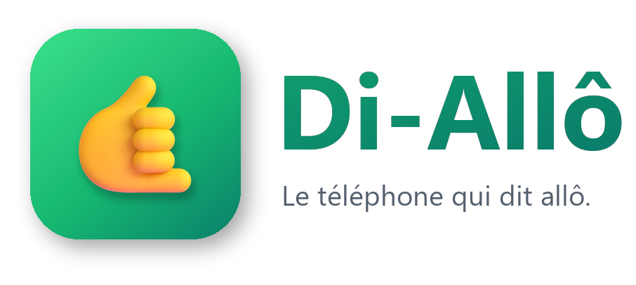

<p align="center">
  
</p>

<p align="center">
  <b>Le téléphone qui dit allô 🤙</b> · <i>by Soaresden</i><br>
  Une appli Téléphone complète pour Android, gratuite et sans pub, faite pour remplacer le dialer de ton téléphone.<br>
  👉 <a href="docs/index.html">Toutes les fonctionnalités</a> · <a href="CHANGELOG.md">Nouveautés</a>
</p>

---

## ✨ Ce que fait Di-Allô

### ⌨️ Clavier
- **Touches musicales** : piano, guitare, violon, violoncelle, batterie… (sons synthétisés, aucun fichier audio)
- 🎵 **Mode composeur** (grosse note à droite du bouton d'appel) : les touches jouées s'écrivent à l'écran, ␣ pour une pause, ⌫ pour corriger, puis 💾 pour garder. Mélodies modifiables, lecture façon karaoké (la note en cours s'allume), recueil d'airs du domaine public, partage en chiffres.
- Recherche **T9** sur les noms *et* sur les chiffres du numéro (« 32 » trouve tous les numéros qui contiennent 32), avec surlignage
- Candidats triés par nombre d'appels, contacts à plusieurs numéros gérés
- Touche ⭐ **Favoris** directement sur le clavier
- ⚡ **Numérotation rapide** : appui long sur 2…9 pour appeler un contact (attribution depuis le clavier ou les réglages)
- Appui long sur un appel récent : fiche du contact, **sélection multiple** pour supprimer des appels, ou 📌 envoyer le contact sur l'écran d'accueil
- Numéros au **format international** (+33 6 12 34 56 78) avec le type de ligne (📱 mobile / ☎️ fixe)

### 📞 Écran d'appel
- Haut-parleur, muet, clavier DTMF, attente, Bluetooth
- **Double appel** : mettre en attente et répondre, raccrocher et répondre, basculer entre les deux
- **Conférence** : fusionner, parler en privé à un participant, raccrocher un participant
- **Refuser avec un SMS** (réponses rapides personnalisables)
- 🎙️ **Enregistrement des appels en MP3**, les deux voix, sans autre appli : bouton 🔴 pendant l'appel, ou automatique (contacts / tous). Fichiers rangés dans `Rec/` de ton dossier (`aaaa-mm-jj-hhmmss-NOM.mp3`), reliés aux appels (🎙️ dans Récents), listés par contact dans l'onglet **REC** et sur la fiche du contact. Configuration guidée une seule fois (débogage sans fil).
- 📝 **Notes pendant l'appel**, rangées par contact. La dernière note s'affiche quand la personne rappelle.
- 🕘 **Historique** des appels avec la personne, directement dans l'écran d'appel
- Écran éteint contre la joue (capteur de proximité)
- Notification d'appel et bandeau « appel en cours » quand on réduit l'écran

### 🤚 Capteurs
- **Haut-parleur automatique** : à l'oreille → écouteur, éloigné ou posé à plat → haut-parleur
- **Porter à l'oreille pour décrocher** (protégé contre les déclenchements dans la poche)
- **Retourner le téléphone pour couper la sonnerie et la vibration**, puis double vibration quand cet appel est terminé

### 👥 Contacts, récents, notes
- Libellés **Google** (groupes), index A–Z au doigt, 5 tris (dont un tri « intelligent »)
- Fiche contact : tous les numéros avec leur étiquette, triés par nombre d'appels, drapeau du pays
- 🗺️ **Carte** des adresses de tes contacts (OpenStreetMap, sans clé)
- Onglet **Notes** avec recherche plein texte

### 📊 Stats
- Périodes cliquables, zoom année → mois → jour
- Origine des numéros (pays, mobile / fixe, régions), habitudes horaires, classements
- Faits marrants : la personne que tu ghostes le plus, ton plus vieil appel, ton record…
- 🎁 **Di-Allô Wrapped** : ton année au téléphone en stories, à partager en image

### 🎨 Et aussi
- 23 thèmes à forte personnalité : polices, décors animés (Plongée avec requin-baleine, mantas et tortues ; Ocean Drive au coucher du soleil ; Synthwave, Cabaret, Arcade, Terminal…), forme et style des touches
- Widgets d'écran d'accueil : **Favoris** (4 ou 8, favoris ou plus appelés, 4 styles) et **contact 1×1**, un appui, un appel
- 🌍 **6 langues** : français, anglais, espagnol, allemand, italien, portugais (automatique ou au choix)
- Touche le logo 😎 pour une petite surprise
- 📁 **Dossier de travail** : notes et réglages synchronisés automatiquement, et **sauvegarde quotidienne complète** du journal d'appels et des SMS/MMS (photos comprises) au format *SMS Backup & Restore*. Restauration intégrée.

---

## 📲 Installation

1. Télécharge le dernier `Di-Allo.apk` dans les [Releases](../../releases).
2. Installe-le (autorise l'installation depuis ton navigateur ou ton gestionnaire de fichiers si Android le demande).
3. Ouvre Di-Allô, accepte les autorisations, puis **« Définir comme téléphone par défaut »**.
4. Choisis un **dossier de travail** (par exemple `Di-Allo`) : notes, réglages et sauvegardes y seront rangés.

> Testé sur Xiaomi (HyperOS). Android 10 minimum.

### Autorisations
| Autorisation | Pourquoi |
|---|---|
| Journal d'appels, contacts, téléphone | Afficher, rechercher et passer les appels |
| SMS (lecture) | Sauvegarde des SMS/MMS, réponses rapides |
| Notifications | Appel en cours, appel entrant |
| Internet | Tuiles de la carte et géocodage des adresses |
| Capteurs | Proximité et accéléromètre (haut-parleur auto, gestes), sans autorisation à demander |

Aucune donnée ne quitte le téléphone : pas de compte, pas de pub, pas de pisteur.

---

## ⚠️ Limites (Android, pas Di-Allô)
- **Enregistrement d'appel** : Android le réserve aux applis système et aux outils de développement. Di-Allô passe donc par le **débogage sans fil** (association une fois ; après un redémarrage, il faut le Wi-Fi pour relancer le service).
- Le haut-parleur auto et les gestes ne concernent que les appels téléphoniques, pas WhatsApp, Teams, etc.
- Restaurer des SMS demande que Di-Allô soit **temporairement** l'appli SMS par défaut. L'appli te guide et te ramène ensuite à Google Messages.

---

## 🛠️ Compiler

Prérequis : JDK 17 et le SDK Android (via Android Studio ou les outils en ligne de commande).

```bash
./gradlew :app:assembleDebug
# APK : app/build/outputs/apk/debug/app-debug.apk
```

La version est automatique : `AAAA-MM-JJ-NN` (NN = numéro du build du jour), voir `version.properties`.

Stack : Kotlin, Jetpack Compose (Material 3), Telecom `InCallService`, osmdroid, Coil.

---

## 🙏 Crédits
- Logo et animation du logo : [Fluent Emoji](https://github.com/microsoft/fluentui-emoji) 3D de Microsoft (licence MIT)
- Polices des thèmes : [Google Fonts](https://github.com/google/fonts) (SIL Open Font License / Apache-2.0)
- Cartes : © les contributeurs d'[OpenStreetMap](https://www.openstreetmap.org/copyright), via [osmdroid](https://github.com/osmdroid/osmdroid)

## 📄 Licence
[MIT](LICENSE). Libre, gratuit, fais-en ce que tu veux.

<p align="center"><sub>Di-Allô · by <a href="https://github.com/soaresden">Soaresden</a></sub></p>
